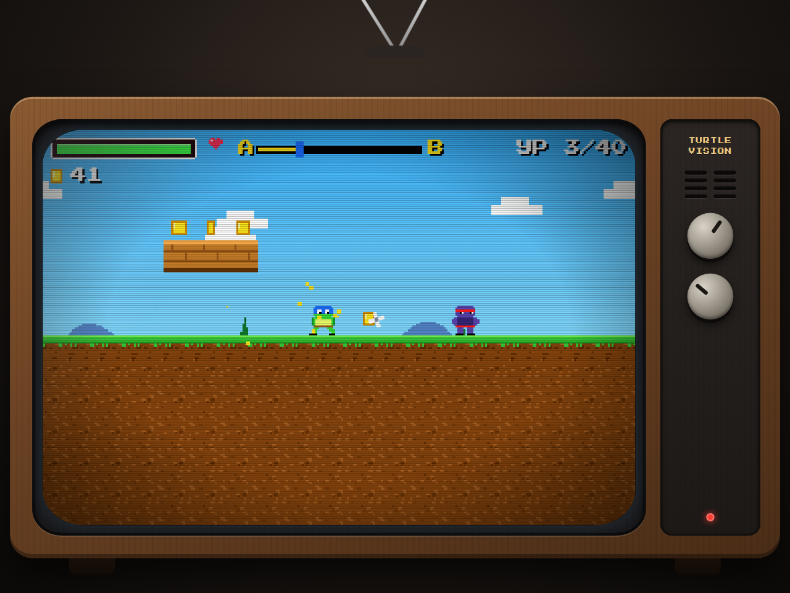

# 🐢 Turtle Ninja Quest — ретро-игра в браузере

8-битный экшн-платформер про черепашек-ниндзя. Играется прямо в браузере на экране «старого телевизора» — без установки, без интернета после загрузки страницы.

**▶ Играть: https://ol0710.github.io/playnin/**

## Как играть

| Клавиша | Действие |
|---|---|
| ← → / A D | ходьба |
| Пробел / W / ↑ | прыжок (можно прыгать на врагов сверху) |
| J | удар мечом |
| K (удерживать) | щит-панцирь: блокирует удары и пули спереди |
| L | бросок сюрикена |
| Esc / P | пауза |
| M | звук вкл/выкл |
| **[ ]** или верхняя ручка ТВ | «канал»: переключить уровень (среди открытых), прямо во время игры |
| **- +** или нижняя ручка ТВ | громкость (клик, правая кнопка мыши и колесо тоже работают) |

В меню: стрелки + Enter или мышь.

Дойди от точки **A** до портала **B** — откроется следующий уровень. Собирай монеты и трать их в «Прокачке» (атака, защита, здоровье). Всего **40 уровней** в 4 мирах (по 10): город (крыши, улица, пиццерия), канализация, логово врагов (порт, лаборатория, техно-крепость) и остров додзё (бамбук, пагода, вулкан). В каждом уровне 3 зоны и 3 типа врагов: наземные (ниндзя клана, роботы-мышеры), летающие (дроны, летучие мыши), стреляющие (боевые роботы). Подбирай вкусности (пицца, бургер, пончик, мороженое, онигири, капкейк) — они лечат. В конце уровня тебя встречает **главарь клана** с похвалой, а на 10, 20, 30 и 40 уровнях с ним нужно сразиться.

## Запуск у себя

1. Нажми **Code → Download ZIP** (или `git clone https://github.com/ol0710/playnin.git`).
2. Распакуй и открой `index.html` двойным кликом. Никаких сборщиков и сервера не нужно.

## О проекте

- Чистый HTML + CSS + JavaScript, без библиотек и внешних файлов: вся графика нарисована кодом, звук синтезируется WebAudio, шрифт Press Start 2P (OFL) встроен.
- Язык интерфейса: русский, английский, немецкий, французский — по языку браузера, переключается в главном меню.
- Возраст 12+ (мультяшное насилие без крови).
- Прогресс **не сохраняется**, авторизации нет, игра одиночная.
- «Банк» и «Реклама» — демонстрация механик: реальные деньги не списываются, рекламный ролик — заглушка.
- Только для компьютера с клавиатурой (мобильной версии нет).

Это некоммерческий фанатский проект; оригинальные названия и логотипы франшизы не используются.

## Лицензия

Код — MIT (см. `LICENSE`). Шрифт Press Start 2P — SIL OFL 1.1 (`assets/fonts/OFL.txt`).

---

# English

**Turtle Ninja Quest** is a retro 8-bit platformer that runs in the browser on a "vintage TV" screen. Play: https://ol0710.github.io/playnin/ — or download the ZIP and open `index.html` (no server or build needed).

Controls: arrows/AD move · Space/W jump · J sword · K shield · L throwing star · Esc/P pause · M mute.
40 levels, 3 zones each, 3 enemy types, coin-funded upgrades (attack / defense / health). RU/EN/DE/FR. Progress is not saved. Keyboard only (desktop).
